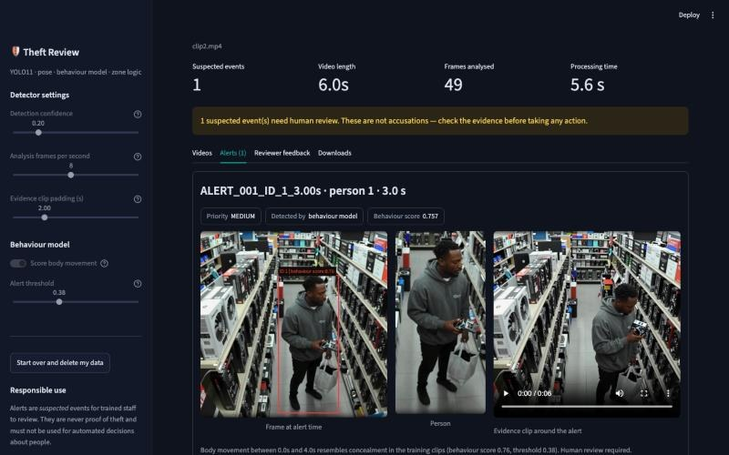

# Retail Theft Detection — Human-in-the-Loop Security Review

[](https://github.com/ennap3a/retail-theft-detection/actions/workflows/ci.yml)


A computer-vision system that reviews retail CCTV footage for **suspected concealment** of
products and raises alerts **for a human to review**. Two independent signals run side by side:

- **Behaviour model.** Trained on 365 labelled clips, it scores each tracked person's body
  movement — a hand going to a pocket, waistband or bag — from their pose keypoints alone, so it
  ignores the store background, camera and lighting. It averages a spatial-temporal graph network
  (ST-GCN) with a gradient-boosting model on hand-crafted movement features.
- **Zone rules.** An explainable event chain: a customer reaches a product zone, an item leaves
  the shelf and then stops being visible after the hand moves toward clothing or a bag.

Optional checkout and exit zones set the priority: hiding an item and then reaching an exit
without passing a checkout is flagged **HIGH**.

<p align="center">
  
  <br><em>Prototype alert screen across four camera feeds (Colab stage).</em>
</p>

> **Responsible-AI design.** The system never accuses anyone. Every output is labelled a
> *suspected event*, comes with the evidence used to raise it, and must be confirmed or
> dismissed by a trained reviewer. Do not use it for automated enforcement.

## What it does

| Stage | How |
|---|---|
| Person detection & tracking | YOLO11n + ByteTrack (unique ID per person) |
| Hand / body keypoints | YOLO11n-pose (wrists, shoulders, hips → torso box) |
| Shelf change detection | OpenCV frame differencing inside user-drawn product zones |
| Behaviour model | ST-GCN on 4-second skeleton windows + gradient boosting on movement features, averaged per person |
| Behaviour rules | Rule-based state machine per track (see below) |
| Evidence | Annotated video, item crop, person crop, 4-second clip, JSON/CSV report |
| Review | Local web app: side-by-side video, alert list, TP/FP/FN/TN evaluation log, ZIP export |

### Behaviour model

Each tracked person is cut into 4-second windows (one every second). A window holds 17 COCO
keypoints per frame at 8 fps, normalised to the person's hips and height, plus joint velocity,
body velocity and distance from the hands to any bag. A small ST-GCN (4 graph-convolution
blocks) scores every window; a person's score is their most suspicious window.

The training clips are only labelled at clip level ("theft happens somewhere in this clip"), so
the network is trained with **multiple-instance learning**: a clip's score is the maximum over all
its people and windows, and only that maximum is compared with the label. The shipped model is an
ensemble of the five cross-validation fold models.

The second half summarises each person over 10-second windows with interpretable signals (wrist
distance to the hips, hand inside the torso box, wrist hidden while the body is visible, reaching
above the shoulders, crouching, hand near a bag, head turning) and scores them with gradient
boosting. The two probabilities are averaged; cross-validation showed the average beats either
model alone. See [Evaluation](#evaluation) and the model card
[`models/behaviour_model.json`](models/behaviour_model.json).

### Behaviour rules

- Bags, baskets, carts, backpacks and suitcases are **containers**, never products.
- A product **visible in the hand** is browsing, not theft. Short detection gaps are
  tolerated with a 1.25 s visibility grace window to avoid flickering alarms.
- The detector remembers the shelf patch where the change started. If the item is
  **returned**, or the patch visually returns to its original state, the event is cleared.
- If the person **blocks** the product zone, the detector waits instead of treating the
  shelf as empty.
- An item that disappears after moving near the torso or a bag becomes *possible
  concealment*. A confirmed hidden item raises a **MEDIUM** review alert straight away; the person
  does not have to leave an area first.
- Checkout and exit zones are optional. Reaching an exit afterwards without passing a checkout
  raises the alert to **HIGH**; going to a checkout lowers it to **LOW** (check the payment).

All thresholds live in [`DetectorSettings`](retail_theft_detector/detector.py).

## The Streamlit app

<p align="center">
  
</p>

| 1. Click to outline product, checkout and exit zones | 2. Review each alert with its evidence |
|---|---|
|  |  |

A four-step guided workflow:

1. **Upload** one CCTV clip (MP4, MOV, AVI, MKV or WEBM, up to 500 MB).
2. **Draw zones** — pick a clear setup frame, then click on the image to outline one or more
   **product** zones. Everything else is the shop floor. **Checkout** and **exit** zones are
   optional and only change alert priority.
3. **Run analysis** — live progress while the detector tracks people, reads pose, applies the
   zone rules and scores body movement with the behaviour model. Confidence, analysis frame rate,
   evidence clip length and the skeleton alert threshold are adjustable in the sidebar.
4. **Review** — side-by-side original and annotated video, one card per alert (priority, which
   signal raised it, skeleton score) with the frame, shelf crop, person crop and evidence clip, a reviewer feedback form (logged as TP / FP / FN /
   TN) and downloads: alerts CSV, summary JSON, annotated video and a full review-package ZIP.

**Start over and delete my data** removes the uploaded video and every generated file.

## Quick start

```bash
git clone https://github.com/ennap3a/retail-theft-detection.git
cd retail-theft-detection
python -m venv .venv
source .venv/bin/activate          # Windows: .venv\Scripts\activate
pip install -r requirements.txt
streamlit run streamlit_app.py
```

Open <http://localhost:8501>. Ultralytics downloads `yolo11n.pt` and `yolo11n-pose.pt`
automatically on the first analysis. On a laptop CPU a 10-second 544×544 clip takes about
10 seconds at the default 8 analysed frames per second; a GPU is much faster.

## Deploy on Streamlit Community Cloud

1. Sign in at [share.streamlit.io](https://share.streamlit.io) with GitHub and choose
   **Create app → Deploy a public app from GitHub**.
2. Repository `ennap3a/retail-theft-detection`, branch `main`, main file `streamlit_app.py`.
3. Under **Advanced settings**, choose Python 3.12 and add these secrets so uploads are short
   and are deleted automatically:

   ```toml
   MAX_VIDEO_SECONDS = "60"
   RETENTION_HOURS = "6"
   ```

`requirements.txt` installs CPU-only PyTorch and `packages.txt` adds the system libraries
OpenCV needs, so no extra setup is required. Free cloud instances are CPU-only; keep demo
clips short.

| Setting | Default | Purpose |
|---|---|---|
| `MAX_VIDEO_SECONDS` | `0` (no limit) | Reject longer uploads on a hosted demo |
| `RETENTION_HOURS` | `0` (keep) | Delete uploaded projects older than this |

## Evaluation

All numbers are from **5-fold stratified cross-validation on 365 clips** (134 suspicious,
231 normal): every clip is scored only by models that never saw it during training. A clip counts
as flagged when its most suspicious person-window passes the threshold.

| Model | ROC-AUC | Recall | Precision | False alarms on normal clips |
|---|---|---|---|---|
| **Behaviour model (shipped)** — at default threshold 0.38 | **0.835** | **81%** | **57%** | **35%** |
| Skeleton network only | 0.792 | 81% | 50% | 48% |
| Movement features only | 0.815 | 81% | 59% | 32% |
| External action model ([SilentVision](docs/silentvision_model_evaluation.md)) | — | 48% | 28% | 73% |

The default threshold is the highest one that still catches 80% of suspicious clips, because
missed theft is the costlier error for a review tool. Lowering it in the sidebar catches more:
at 0.24 the behaviour model reaches 90% recall at a 50% false-alarm rate.

**Is it learning behaviour or the dataset?** The suspicious and normal clips partly come from
different sources, and camera metadata alone (clip length, resolution, frame rate, number of
people) predicts the label with ROC-AUC 0.75. Two checks show the model learns more than that:

- Within a single camera format, where the source cannot help, it still separates the classes:
  ROC-AUC 0.78 on 640×480 clips and 0.87 on 704×576 clips.
- Its scores are almost uncorrelated with clip length (r = 0.06), and adding the model to the
  metadata raises ROC-AUC from 0.75 to 0.82.

Track length and people count were removed from the features for the same reason.

On three store clips from a separate theft folder that are not in the training set, the behaviour
model flagged two that the zone rules missed and scored the third below the threshold. The zone
rules have not yet been measured at scale.

Full results: [`models/behaviour_model.json`](models/behaviour_model.json) ·
[SilentVision raw metrics](docs/benchmarks/silentvision_365_clips.json) ·
[evaluation plan](docs/training_and_evaluation.md).

## Project structure

```text
streamlit_app.py              Streamlit entry point (sidebar, step routing)
ui/
  page_upload.py              Step 1: upload
  page_zones.py               Step 2: setup frame and click-to-draw zones
  page_analyse.py             Step 3: detector run with live progress
  page_review.py              Step 4: alerts, evidence, feedback, downloads
  drawing.py                  Zone rendering and zone-document helpers (pure functions)
  state.py, theme.py          Session state and styling
retail_theft_detector/
  detector.py                 Detection, tracking, pose, behaviour state machine, evidence
  review.py                   Projects, evaluation log (TP/FP/FN/TN), review-package export
  zones.py                    Zone validation and storage
  video.py                    Video probing, frame extraction, safe filenames
  project.py                  Per-upload project folders and metadata
  pose_tracks.py              Per-person keypoint recorder shared by the app and training
  skeleton_model.py           ST-GCN network, windowing and the combined behaviour scorer
  behaviour.py                Hand-crafted movement features (second half of the behaviour model)
  config.py                   Paths and environment settings
  training.py                 CLI: build YOLO datasets, train, evaluate mAP
  silentvision_action_model.py  Optional wrapper for the external action classifier
models/                                Trained behaviour model and its model card (behaviour_model.json)
tools/train_behaviour_model.py         Pose extraction, cross-validation and training
tools/evaluate_silentvision_model.py   Batch evaluation of the external baseline
notebooks/train_yolo_colab.ipynb       GPU training in Google Colab
docs/                                  Product plan, training, testing and evaluation notes
tests/                                 pytest suite
.streamlit/config.toml, packages.txt   Streamlit theme, upload limit and cloud system packages
```

## Training the behaviour model

Put labelled clips in two folders, `suspicious_videos/` and `normal_videos/`, then:

```bash
pip install -r requirements-dev.txt
# 1. run tracking + pose once per clip (cached under data/behaviour_cache/)
python tools/train_behaviour_model.py extract --clips /path/to/clips --workers 4
# 2. cross-validate both halves and their combination, then save the models + model card
python tools/train_behaviour_model.py train
```

Extraction uses exactly the same detector, tracker and pose settings as the app, so the model is
trained on the same input it sees in production. `--target-recall` (default 0.8) sets how many
suspicious clips the default threshold should catch.

## Custom object detector

```bash
python -m retail_theft_detector.training init-dataset --name retail_theft_v1 \
    --classes person held_product bag basket_cart
python -m retail_theft_detector.training extract-frames --project-id <PROJECT_ID> \
    --dataset retail_theft_v1 --every-seconds 0.5 --limit 300
python -m retail_theft_detector.training check-dataset --dataset retail_theft_v1
```

See [docs/training_and_evaluation.md](docs/training_and_evaluation.md) and
[docs/colab_training.md](docs/colab_training.md).

## Development

```bash
pip install -r requirements-dev.txt
ruff check .
pytest
```

CI runs lint and tests on Python 3.11, 3.12 and 3.13.

## Limitations

- Uses COCO-pretrained YOLO weights; small items (cosmetics, phones) are often missed
  without custom training, which weakens the zone rules (the behaviour model does not need them).
- The behaviour model only knows the 365 training clips (mostly fixed indoor cameras). Different
  camera heights and angles can change its scores; retrain with your own footage.
- Clip-level labels mean the model learns *that* a clip contains theft, not exactly *when*;
  alert timestamps are the most suspicious 4-second window, not a precise moment.
- One camera per run, offline video only — no live RTSP stream yet.
- Rules are tuned on a small number of clips and need per-store zone setup.
- Occlusion by other shoppers, unusual camera angles and low light reduce reliability.
- Event-level accuracy on suspicious footage has not yet been measured at scale.

## Roadmap

- [x] Streamlit app with click-to-draw zones and reviewer feedback
- [ ] Public hosted demo
- [x] Behaviour model (ST-GCN + movement features) trained on 365 labelled clips
- [x] Product-only zones with optional checkout / exit priority
- [ ] Mark the theft moment in each suspicious clip and retrain with time-level labels
- [ ] Custom `hand` / `held_product` / `bag` detector trained on store footage
- [ ] Live RTSP/CCTV input and multi-camera view
- [ ] Face blurring in exported evidence for privacy

## Privacy and data

No video is committed to this repository. Uploaded footage and results stay on the local
machine under `data/` (git-ignored). If you deploy anything like this, follow local
CCTV, data-protection and employment law, and keep a human reviewer in the loop.

## Built with

Ultralytics YOLO11 & YOLO11-pose · ByteTrack · OpenCV · NumPy · FFmpeg · Streamlit · Python

## License

Portfolio project — all rights reserved. See [LICENSE](LICENSE).
