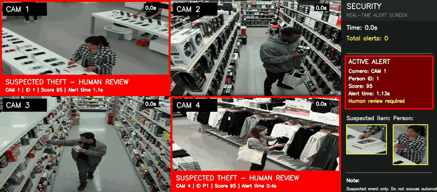
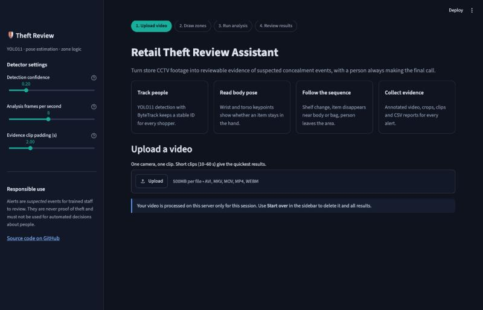
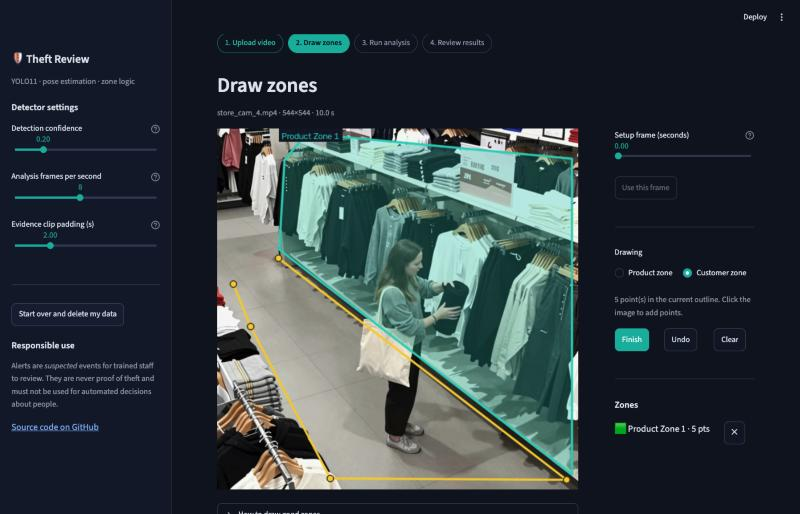
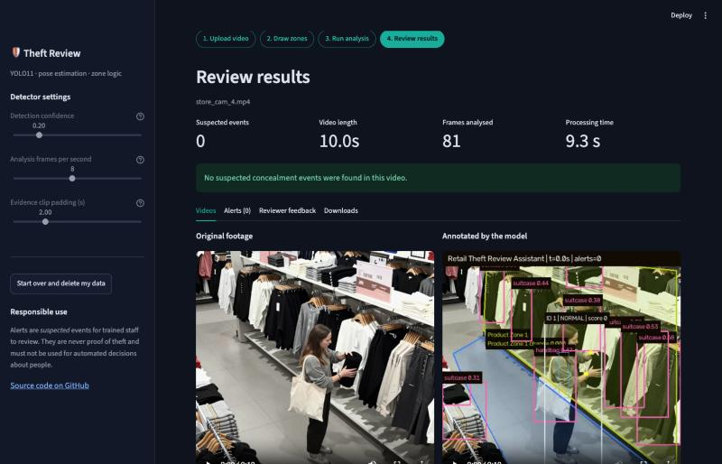

# Retail Theft Detection — Human-in-the-Loop Security Review

[](https://github.com/ennap3a/retail-theft-detection/actions/workflows/ci.yml)


A computer-vision system that reviews retail CCTV footage for **suspected concealment** of
products. It goes beyond object detection: it follows the *sequence* of behaviour —
a customer reaches a product zone, an item leaves the shelf, the item stops being visible
in the hand after moving toward clothing or a bag, and the person then leaves the
browsing area — and only then raises an alert **for a human to review**.

<p align="center">
  
  <br><em>Prototype alert screen across four camera feeds (Colab stage).</em>
</p>

> **Responsible-AI design.** The system never accuses anyone. Every output is labelled a
> *suspected event*, comes with the evidence used to raise it, and must be confirmed or
> dismissed by a trained reviewer. Do not use it for automated enforcement.

## What it does

| Stage | How |
|---|---|
| Person detection & tracking | YOLO11n + ByteTrack (unique ID per person) |
| Hand / body keypoints | YOLO11n-pose (wrists, shoulders, hips → torso box) |
| Shelf change detection | OpenCV frame differencing inside user-drawn product zones |
| Behaviour logic | Rule-based state machine per track (see below) |
| Evidence | Annotated video, item crop, person crop, 4-second clip, JSON/CSV report |
| Review | Local web app: side-by-side video, alert list, TP/FP/FN/TN evaluation log, ZIP export |

### Behaviour rules

- Bags, baskets, carts, backpacks and suitcases are **containers**, never products.
- A product **visible in the hand** is browsing, not theft. Short detection gaps are
  tolerated with a 1.25 s visibility grace window to avoid flickering alarms.
- The detector remembers the shelf patch where the change started. If the item is
  **returned**, or the patch visually returns to its original state, the event is cleared.
- If the person **blocks** the product zone, the detector waits instead of treating the
  shelf as empty.
- An item that disappears after moving near the torso or a bag becomes *possible
  concealment*. An alert is raised **only** after possible concealment **and** leaving the
  customer zone.

All thresholds live in [`DetectorSettings`](retail_theft_detector/detector.py).

## The Streamlit app

<p align="center">
  
</p>

| 1. Click to outline product and customer zones | 2. Review the original and annotated video |
|---|---|
|  |  |

A four-step guided workflow:

1. **Upload** one CCTV clip (MP4, MOV, AVI, MKV or WEBM, up to 500 MB).
2. **Draw zones** — pick a clear setup frame, then click on the image to outline one or more
   product zones and one customer zone. Zones are validated before you can continue.
3. **Run analysis** — live progress while the detector tracks people, reads pose and applies
   the behaviour rules. Confidence, analysis frame rate and evidence clip length are adjustable
   in the sidebar.
4. **Review** — side-by-side original and annotated video, one card per alert with the frame,
   shelf crop, person crop and evidence clip, a reviewer feedback form (logged as TP / FP / FN /
   TN) and downloads: alerts CSV, summary JSON, annotated video and a full review-package ZIP.

**Start over and delete my data** removes the uploaded video and every generated file.

## Quick start

```bash
git clone https://github.com/ennap3a/retail-theft-detection.git
cd retail-theft-detection
python -m venv .venv
source .venv/bin/activate          # Windows: .venv\Scripts\activate
pip install -r requirements.txt
streamlit run streamlit_app.py
```

Open <http://localhost:8501>. Ultralytics downloads `yolo11n.pt` and `yolo11n-pose.pt`
automatically on the first analysis. On a laptop CPU a 10-second 544×544 clip takes about
10 seconds at the default 8 analysed frames per second; a GPU is much faster.

A lightweight alternative UI with no Streamlit dependency is also included:
`python run_local_app.py` → <http://127.0.0.1:7860>.

## Deploy on Streamlit Community Cloud

1. Sign in at [share.streamlit.io](https://share.streamlit.io) with GitHub and choose
   **Create app → Deploy a public app from GitHub**.
2. Repository `ennap3a/retail-theft-detection`, branch `main`, main file `streamlit_app.py`.
3. Under **Advanced settings**, choose Python 3.12 and add these secrets so uploads are short
   and are deleted automatically:

   ```toml
   MAX_VIDEO_SECONDS = "60"
   RETENTION_HOURS = "6"
   ```

`requirements.txt` installs CPU-only PyTorch and `packages.txt` adds the system libraries
OpenCV needs, so no extra setup is required. Free cloud instances are CPU-only; keep demo
clips short.

| Setting | Default | Purpose |
|---|---|---|
| `MAX_VIDEO_SECONDS` | `0` (no limit) | Reject longer uploads on a hosted demo |
| `RETENTION_HOURS` | `0` (keep) | Delete uploaded projects older than this |

## Evaluation

Honest numbers so far; the project is still at the prototype stage.

| Test | Result |
|---|---|
| Rule-based detector on 5 normal store clips | 5/5 correct (no false alerts) |
| Rule-based detector on suspicious clips | Not yet measured at scale — next milestone |
| External action-recognition baseline ([SilentVision](docs/silentvision_model_evaluation.md)) on 365 clips (134 suspicious / 231 normal) | Precision 0.28 · Recall 0.48 · F1 0.35 · **73% false-alarm rate** |

The external clip classifier raised false alarms on almost three out of four normal videos,
which is why this project uses an explainable zone + pose + tracking pipeline as the primary
signal and treats action models only as a possible second opinion
([details](docs/silentvision_model_evaluation.md), [raw metrics](docs/benchmarks/silentvision_365_clips.json)).

Planned metrics: event precision/recall, false alerts per camera-hour, alert timestamp error,
and detection mAP for `person`, `held_product`, `bag`, `basket_cart`
([plan](docs/training_and_evaluation.md)).

## Project structure

```text
streamlit_app.py              Streamlit entry point (sidebar, step routing)
ui/
  page_upload.py              Step 1: upload
  page_zones.py               Step 2: setup frame and click-to-draw zones
  page_analyse.py             Step 3: detector run with live progress
  page_review.py              Step 4: alerts, evidence, feedback, downloads
  drawing.py                  Zone rendering and zone-document helpers (pure functions)
  state.py, theme.py          Session state and styling
retail_theft_detector/
  detector.py                 Detection, tracking, pose, behaviour state machine, evidence
  review.py                   Projects, evaluation log (TP/FP/FN/TN), review-package export
  zones.py                    Zone validation and storage
  video.py                    Video probing, frame extraction, safe filenames
  project.py                  Per-upload project folders and metadata
  config.py                   Paths and environment settings
  web_app.py, multipart.py    Lightweight standard-library web UI
  training.py                 CLI: build YOLO datasets, train, evaluate mAP
  silentvision_action_model.py  Optional wrapper for the external action classifier
tools/evaluate_silentvision_model.py   Batch evaluation of the external baseline
notebooks/train_yolo_colab.ipynb       GPU training in Google Colab
docs/                                  Product plan, training, testing and evaluation notes
tests/                                 pytest suite
.streamlit/config.toml, packages.txt   Streamlit theme, upload limit and cloud system packages
```

## Custom training

```bash
python -m retail_theft_detector.training init-dataset --name retail_theft_v1 \
    --classes person held_product bag basket_cart
python -m retail_theft_detector.training extract-frames --project-id <PROJECT_ID> \
    --dataset retail_theft_v1 --every-seconds 0.5 --limit 300
python -m retail_theft_detector.training check-dataset --dataset retail_theft_v1
```

See [docs/training_and_evaluation.md](docs/training_and_evaluation.md) and
[docs/colab_training.md](docs/colab_training.md).

## Development

```bash
pip install -r requirements-dev.txt
ruff check .
pytest
```

CI runs lint and tests on Python 3.11, 3.12 and 3.13.

## Limitations

- Uses COCO-pretrained YOLO weights; small items (cosmetics, phones) are often missed
  without custom training.
- One camera per run, offline video only — no live RTSP stream yet.
- Rules are tuned on a small number of clips and need per-store zone setup.
- Occlusion by other shoppers, unusual camera angles and low light reduce reliability.
- Event-level accuracy on suspicious footage has not yet been measured at scale.

## Roadmap

- [x] Streamlit app with click-to-draw zones and reviewer feedback
- [ ] Public hosted demo
- [ ] Event-level precision/recall on a labelled suspicious set
- [ ] Custom `held_product` / `bag` detector trained on store footage
- [ ] Action-recognition model as a second-stage check
- [ ] Live RTSP/CCTV input and multi-camera view
- [ ] Face blurring in exported evidence for privacy

## Privacy and data

No video is committed to this repository. Uploaded footage and results stay on the local
machine under `data/` (git-ignored). If you deploy anything like this, follow local
CCTV, data-protection and employment law, and keep a human reviewer in the loop.

## Built with

Ultralytics YOLO11 & YOLO11-pose · ByteTrack · OpenCV · NumPy · FFmpeg · Streamlit · Python

## License

Portfolio project — all rights reserved. See [LICENSE](LICENSE).
